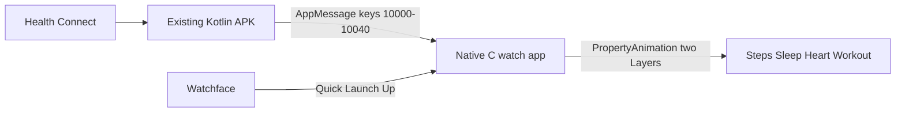

# Port Health Glance watch app to C

For Hermes: this is a **watch-only** rewrite. Do not touch the Kotlin companion except if generated AppMessage key numbers change (they must not). Do not iterate Alloy/JS animations. Land C, then **verify on the physical watch** before calling a step done.

## Why C

Alloy/XS + Poco share Emery’s 128 KB with the framebuffer. Two-card JS blits OOM. Native C uses layers + `PropertyAnimation` like every “complicated” Pebble app. Official FAQ: use C for smallest footprint; Alloy is Time 2/Round 2 JS. Docs: [C vs Alloy](https://developer.repebble.com/faqs/), [new-project --c](https://developer.repebble.com/guides/tools-and-resources/pebble-tool/).

## Branch

```bash
git checkout -b watch-c-sdk
```

Work only on this branch. Do not force-push `main`.

## Keep identical (companion contract)

| Field               | Value                                                          | Where                                                                                                                                         |
| ------------------- | -------------------------------------------------------------- | --------------------------------------------------------------------------------------------------------------------------------------------- |
| UUID                | `ced3f81d-aaae-4ee4-a49c-885a247644ec`                         | [`pebble/package.json`](pebble/package.json), [`MessageKeys.kt`](android/app/src/main/java/com/jollybully/healthglance/pebble/MessageKeys.kt) |
| `messageKeys` order | STATS_REQ=10000 … HRV_MS=10040 (append-only)                   | same files                                                                                                                                    |
| Inbox/outbox        | 512 / 64                                                       | current Alloy `Messages({ input: 512, output: 64 })`                                                                                          |
| Nav                 | Up pages Steps→Sleep→Heart→Workout; Down on Steps / Back exits | [`pebble/src/embeddedjs/main.js`](pebble/src/embeddedjs/main.js)                                                                              |

Android already sends root + workout dicts (`GlanceStats.toDictionary` / `toRootDictionary`). C inbox must read integer keys `MESSAGE_KEY_STEPS` etc. from the generated header. **Do not reorder `messageKeys`.**

Live phone still has companion `com.elliotseeds.fitbitglance` (not `com.jollybully.healthglance`). For local `pebble install --phone`, `companionApp.android.apps` must include the installed package or Core will not route AppMessages. Keep UUID unchanged so the existing APK still matches.

## Scaffold

Replace Alloy project type with native C (Emery-only, same as today):

- [`pebble/package.json`](pebble/package.json): drop `"projectType": "moddable"`. `targetPlatforms: ["emery"]`. Keep uuid, displayName, messageKeys, companionApp.
- Delete Alloy-only: `pebble/src/embeddedjs/` (`main.js`, `manifest.json`, `fixture.js`), `pebble/src/c/mdbl.c`.
- Add native sources (suggested split):

```
pebble/src/c/main.c     window, clicks, app_message, timers
pebble/src/c/stats.h    Stats struct (steps, sleep, hr, workout, status)
pebble/src/c/cards.c    4-card draw (cap, pips, hero, bar, meta, footer)
pebble/src/c/anim.c     Full Deck Push + Seam
```

Create via `pebble new-project --c` in a temp dir and copy `src/c/main.c` / wscript patterns if needed; do not change UUID.

No PKJS. No `localStorage`.

## UI port (pixel match the current cards)

Reference draw is [`draw()` in main.js](pebble/src/embeddedjs/main.js) (lines 146–188):

- Display 200×228. Cap 36px. Slots: hero y=44, unit y=108, bar y=136 h=8, meta y=180, footer y=204, inset x=10.
- Caps: Steps `GColorJaegerGreen` / Sleep `GColorDukeBlue` / Heart `GColorImperialPurple` / Workout `GColorOrange` (map from current RGB).
- **Hero numbers: system LECO** (`FONT_KEY_LECO_36_BOLD_NUMBERS` or `FONT_KEY_LECO_42_NUMBERS`), not the JS packed-glyph `fillRect` hack.
- Titles/meta: `FONT_KEY_GOTHIC_24_BOLD` / `FONT_KEY_GOTHIC_18_BOLD`.
- Pips, stage bar (sleep/workout), HR min-max track + square, footer `synced HH:MM` or `Waiting for phone`.
- Optional `#define DEMO 0` with the same fixture numbers as JS for emulator QA.

Each card is a `Layer` whose update proc paints from a `Stats*` + card index. Two layers (outgoing / incoming) for animation; after settle only one is visible.

## Animation: Full Deck Push + Seam (C)

This is the reason for the port. Use Pebble `PropertyAnimation` / `Animation`, **not** JS Timer + two full-screen fills.

Up: incoming layer starts at `y = 228`, outgoing at `y = 0`; animate incoming to `y = 0` and outgoing to `y = -228` (~150–180ms). Down is the opposite. 4px black `Layer` (or fill) at the join (`incoming.origin.y`) for the seam. Optional 4px overshoot then settle.

Do **not** snapshot bitmaps every frame. Layers already composite. If RAM is still tight, animate only the incoming cap bumper first, then snap — but try real two-layer push first; that is what C is for.

## AppMessage

`app_message_open(512, 64)`.

On appear / inbox registered: send `MESSAGE_KEY_STATS_REQ = 1` (same as Alloy `ask()`).

Inbox: copy ints/cstring into `Stats` (`STEPS`, `DIST_M`, `CALORIES`, `RESTING_HR`, `SLEEP_MIN`, stages, `SLEEP_START`/`END`, `UPDATED`, `HR_MIN`/`MAX`, `WO_*`). Mark dirty and redraw. Ignore unknown keys. `STATS_ERR` → status string.

## Hardware gate (required after every install)

Phone `192.168.0.233`, adb `2c9d9d20` (Mi 9T Pro). Companion `com.elliotseeds.fitbitglance`.

After `pebble build` && `pebble install --phone 192.168.0.233`:

1. AppRunState UUID is `ced3f81d-aaae-4ee4-a49c-885a247644ec` (not launcher).
2. No `memory` / `fatal` / `alloy` in watch logs.
3. logcat `HealthGlance` `transmit ... Success` and a non-zero `steps=`.
4. Screenshot (`pebble screenshot --phone ... --no-open`, 15s timeout) shows live numbers, not “Waiting for phone” forever and not a crash screen.

If the app dies on open, fix C before adding animation polish. Do not “simplify back to Alloy.”

## Out of scope

- Kotlin companion rewrite, package rename, GitHub release, history rewrite.
- Aplite/Basalt/other platforms.
- PKJS / Google OAuth worker.


