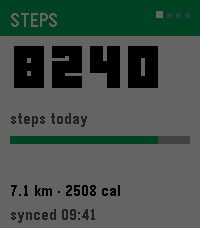
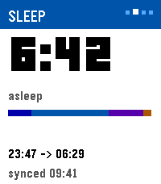
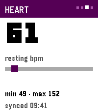
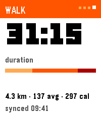

# Health Glance

Health data from **Health Connect** → Android companion → **Pebble Time 2** (Emery).

Any Health Connect writer works (Fitbit, Samsung Health, Google Fit, etc.). The companion reads on-device and pushes stats to the watch over PebbleKit 2.

<p>




</p>

## Downloads

Latest release assets:

- [health-glance.pbw](https://github.com/jollybully/health-glance/releases/latest/download/health-glance.pbw) — watch app (Emery)
- [health-glance-debug.apk](https://github.com/jollybully/health-glance/releases/latest/download/health-glance-debug.apk) — Android companion (sideload / debug)

> If those links 404, open [Releases](https://github.com/jollybully/health-glance/releases) and grab the newest build.

The debug APK is unsigned and intended for sideload, not Play Store.

## Install

1. Install **Core** on your phone and pair your Pebble Time 2 (`coredevices.coreapp` ≥ 1.0.7.7).
2. Sideload `health-glance-debug.apk` (package `com.jollybully.healthglance`; enable install from unknown sources if prompted).
3. Open **Health Glance** → grant Health Connect **read** permissions (and background read).
4. Ensure your fitness app is sharing the metrics you care about into Health Connect.
5. Install `health-glance.pbw` on the watch (Core developer sideload, or `pebble install --phone <PHONE_IP>` if you have the Pebble toolchain).
6. Allow the companion when Core prompts. Open the watch app — it paints last-known stats immediately, then requests a fresh push.

## Replace Pebble Health (UP Quick Launch)

Stock Pebble Health is a separate app. Health Glance does not hijack its UUID — assign this app to **Up** instead:

1. On the watch: **Settings → Quick Launch → Up → Health Glance** (wording may vary slightly in Core).
2. Optionally ignore or hide stock **Pebble Health** so Up no longer opens it.
3. From the watchface, press **Up** → Health Glance opens on **Steps**. Keep pressing **Up** through Sleep → Heart → Workout. **Down on Steps** exits back to the watchface.

| Button | On Steps | On other cards |
|--------|----------|----------------|
| Up | → Sleep | Next card (stops on Workout) |
| Down | Exit → watchface | Previous card |
| Back | Exit | Exit |

Deck: Steps → Sleep → Heart → Workout.

## Repo layout

```
android/   Kotlin companion (Health Connect + PebbleKit Android 2)
pebble/    Native C watch app (Steps / Sleep / Heart / Workout)
docs/      README screenshots (fixture numbers, not live health data)
```

## Build from source (optional)

### Android

- Android Studio / SDK 36
- JDK via Studio JBR (or set `JAVA_HOME`)

```bash
source android/scripts/env.sh
cd android
./gradlew :app:assembleDebug    # or :app:installDebug
```

Debug builds include a Health Connect seeder for emulator QA. Release builds are read-only and omit the seeder.

### Watch

Requires [Pebble Tool](https://developer.repebble.com) + SDK 4.17 (Emery). Native C — no Alloy/Moddable runtime.

```bash
cd pebble
pebble build                             # live build
HG_DEMO=1 pebble build                   # fixture numbers for emulator QA
pebble install --emulator emery
pebble install --phone <PHONE_IP>        # live companion path
```

See `pebble/README.md`.

## Sync behaviour

- Watch paints last-known stats on open, then requests a fresh push (`STATS_REQ`)
- Manual **Sync & push to watch** in the companion
- Periodic WorkManager refresh every **30 minutes** (phone-side cache; AppMessage delivery still needs Core + open watch app)

## Stats contract (companion → watch)

Flat AppMessage keys (see `pebble/package.json` `messageKeys`). Live UI uses root scalars + workout:

- Warm push: Steps / Sleep / Heart (`toRootDictionary`)
- Full push: same + workout keys (`WO_DUR_S`, `WO_CAL`, `WO_AVG_HR`, `WO_DIST_M`, `WO_START`, `WO_END`, `WO_TITLE`)

## Security

- Health data stays on-device; companion reads Health Connect and pushes to the paired watch only
- No Google refresh token in the companion path
- Play Store Health declarations required before a public listing (out of scope for sideload builds)

## License

MIT — see [LICENSE](LICENSE).
