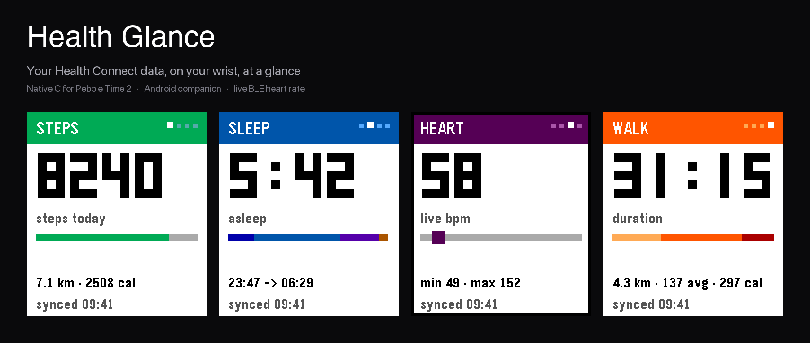
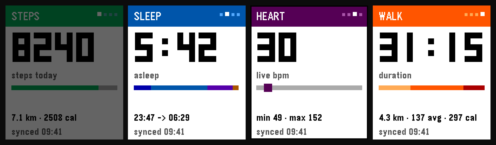
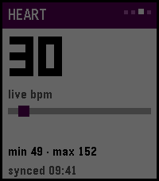

# Health Glance

**Your Health Connect data, on your wrist, at a glance.**

A native C watch app for the **Pebble Time 2 (Emery)** and a small Android companion that reads
**Health Connect** on-device and pushes four numbers to the watch. No account, no cloud, no
Google Fit API keys — just the health data your phone already holds.



---

## What it is

Four cards. That's the whole app.

| Card | Big number | Underneath | Bar |
| --- | --- | --- | --- |
| **Steps** | steps today | distance and calories | progress toward your goal |
| **Sleep** | time asleep | the night's start and end, REM | the night's stages |
| **Heart** | resting bpm — or live bpm from a chest strap | the day's min and max | where you sit in that range |
| **Workouts** | the last session's duration | distance, average hr, calories | time in each heart-rate zone |

<p>

</p>

Deliberately absent: charts to scroll, days to page back through, settings to configure. Health
*glance* means a number you can read mid-stride.

## Highlights

- **Native C**, not Alloy — 12 KB of code and under 1 KB of static RAM, so it launches instantly
  with no JavaScript runtime spinning up under the deck.
- **Pebble-native motion.** The deck drops down over the watchface on launch, cards push with a
  seam, and the hero numbers warp as they change. Nothing bounces, nothing overshoots.
- **Live heart rate from a standard BLE strap.** The phone is the BLE central and republishes
  over PebbleKit; the watch shows your actual beat within ~2 seconds.
- **A pulse frame on the Heart card only**, beating in lub-dub at your measured rate. It stops on
  its own when samples go stale, so it can never pretend a dead strap is live.
- **Works offline.** Every card is cached to flash, so a cold start paints your last numbers with
  a `cached HH:MM` footer before the phone is even awake.
- **Read-only.** The companion never writes health data. Your stats stay between your phone and
  your watch.

<p>

</p>

<sub>The pulse frame, captured frame-by-frame from the watch emulator.</sub>

## Requirements

- **Pebble Time 2** running Core, with the app installed ([`coredevices.coreapp`](https://github.com/coredevices) ≥ 1.0.7.7)
- **Android 8+** (`minSdk` 26), with **Health Connect**: built into Android 14+, installed as an
  app on 13 and below. Health Connect is the only data source.
- Anything that writes to Health Connect: Fitbit, Samsung Health, Google Fit, a Garmin bridge…
- *Optional, for live heart rate:* a BLE chest strap or watch that advertises the standard
  Heart Rate Service (`0x180D`) and **broadcast** enabled — Fitbit calls it *Broadcast Heart Rate*
  or *Heart Rate on Equipment*

## Install

### Downloads

Both halves are always served from the latest release, so these URLs are stable and safe to link:

| File | Direct link |
| --- | --- |
| Watch app | <https://github.com/jollybully/health-glance/releases/latest/download/health-glance-c.pbw> |
| Android companion | <https://github.com/jollybully/health-glance/releases/latest/download/health-glance-companion.apk> |

Or browse [Releases](../../releases) for notes and previous versions.

### 1. The watch app

Install `health-glance-c.pbw` with Core's developer sideload, or:

```bash
pebble install --phone <PHONE_IP>
```

### 2. The companion

Sideload [`health-glance-companion.apk`](https://github.com/jollybully/health-glance/releases/latest/download/health-glance-companion.apk)
(package `com.jollybully.healthglance`; enable "install
unknown sources" when prompted). Then open **Health Glance**:

1. **Grant Health Connect permissions** — read-only access to steps, sleep, heart rate, exercise.
2. **Set your daily step goal** if 10,000 isn't yours. Health Connect stores steps but has no concept
   of a target, so the goal lives in the companion and travels with every sync.
3. **Sync & push to watch** — the first push. After that it refreshes every 30 minutes, and the
   watch asks for fresh numbers whenever you open it.

### 3. Make it your quick launch

Stock Pebble Health has its own UUID; Health Glance doesn't hijack it.

On the watch: **Settings → Quick Launch → Up → Health Glance.** Then, from the watchface, hold
**Up** and the deck drops down over the dial.

## Controls

Three buttons, one grammar: Up and Down move through a list, Select acts on what is shown, Back
leaves.

| Where | Up | Down | Swipe | Select | Back |
| --- | --- | --- | --- | --- | --- |
| Deck | next card | previous card; **Down on Steps goes home** | up = next, down = previous, following the drag | — | exit to watchface |

Swiping drags the card with your finger and lets go into the same page turn the buttons
use, so touch and buttons are one gesture vocabulary rather than two behaviours.

Both ends of the deck answer back instead of going dead: pressing Up on Workouts, or
swiping past either end, leans the card against the edge, over-corrects slightly and
settles. At Steps a firm pull downwards takes you home, the same as the Down button.

That's genuinely all of it. Back is the only way out, so you can never leave the app by accident
while reading a number.

## Live heart rate (optional)

Tap **Connect heart-rate strap** in the companion and leave it running as a foreground service.
It scans for `0x180D`, connects, smooths the reading (median of three), and publishes every 2
seconds or on a 2 bpm change.

On the watch, the Heart card's hero becomes your live bpm, and once live data is arriving the
screen edge beats with it.

Two honest caveats:

- **The phone must be doing the reading.** PebbleOS implements GATT services as a *server* only —
  there is no app-level GATT client on the watch, so a strap cannot talk to it directly
  ([PebbleOS#853](https://github.com/coredevices/PebbleOS/issues/853)).
- **A strap that isn't broadcasting is invisible.** If no device advertises `0x180D`, the app
  says `No strap found (no heart-rate service advertised)` and keeps retrying, rather than
  silently presenting old numbers as live.

## How it works

```
 Health Connect  ──►  Android companion  ──►  PebbleKit  ──►  watch (native C)
 (on-device)          reads, caches            AppMessage       4 cards + flash cache
                              │
                     BLE central (optional)
                              ▼
                      chest strap, 0x180D
```

- The watch paints its flash cache instantly, then sends `STATS_REQ`.
- The companion answers with one flat AppMessage of scalars (47 message keys, append-only).
- Live heart rate travels on its own keys and is **never cached** — a stale "live" value is worse
  than none, so freshness is enforced at 20 seconds on the watch.
- All charts, day-by-day history and drill-down screens were deliberately removed; the app is the
  deck.

## Build from source

### Watch (native C)

Requires [Pebble Tool](https://developer.repebble.com) with SDK 4.17 (Emery).

```bash
cd pebble
pebble build                        # live build
pebble install --emulator emery     # run it in the emulator
```

Build flags: `HG_DEMO=1` seeds fixture numbers for emulator QA, `HG_LAUNCH_HOLD=1` freezes the
launch slide at frame zero, `HG_LAUNCH_MS=<n>` overrides its duration.

### Android companion

```bash
source android/scripts/env.sh
cd android
./gradlew :app:testDebugUnitTest :app:assembleDebug
```

### Emulator QA

`pebble/scripts/` holds the harness used while building this: `emu-shot.sh` (QEMU screendump, since
`pebble screenshot` is unreliable on this SDK), `emu-send-stats.py` (a stand-in companion that
answers `STATS_REQ` and can stream fake live samples with `EMU_BPM`), `emu-launch-app.py`, and
`emu-capture-deck.sh`.

## Repo layout

```
android/   Kotlin companion: Health Connect reads, BLE strap reader, PebbleKit push
pebble/    Native C watch app: four cards, pulse frame, flash cache
docs/      Screenshots, the UX review, design mockups
```

Design notes worth reading: [`docs/ux-review.md`](docs/ux-review.md) — the screen-by-screen
journey and the single button language the app follows.

## Privacy

- Health data is read on the phone and pushed to the paired watch. That's the entire journey.
- **Read-only, in every build.** The APK declares nine `READ_` Health Connect permissions and
  zero `WRITE_` ones: steps, distance, calories, heart rate, resting heart rate, sleep, exercise,
  and background read. Never written, never uploaded.
- No backend, no analytics, no Google API client — Health Connect access is granted to the app
  directly by Android.
- The shipped companion only reads. Demo seeding lives in the debug source set, and the matching
  cleanup button is compiled out of release builds, so a release APK has no write path at all.

## Known limitations

- **Android only.** Health Connect is an Android platform API; there is no iOS companion.
- **Sideload builds.** The APK is unsigned and debug-signed for convenience. A Play Store listing
  would need Health Connect declarations and a signed release.
- **Workouts show the most recent session**, not a list — paging through older sessions went with
  the rest of the drill-down layer.
- **30-minute background refresh.** Faster than that needs the watch to ask (it does, on open) or
  a manual push from the companion.

## License

MIT — see [LICENSE](LICENSE).
